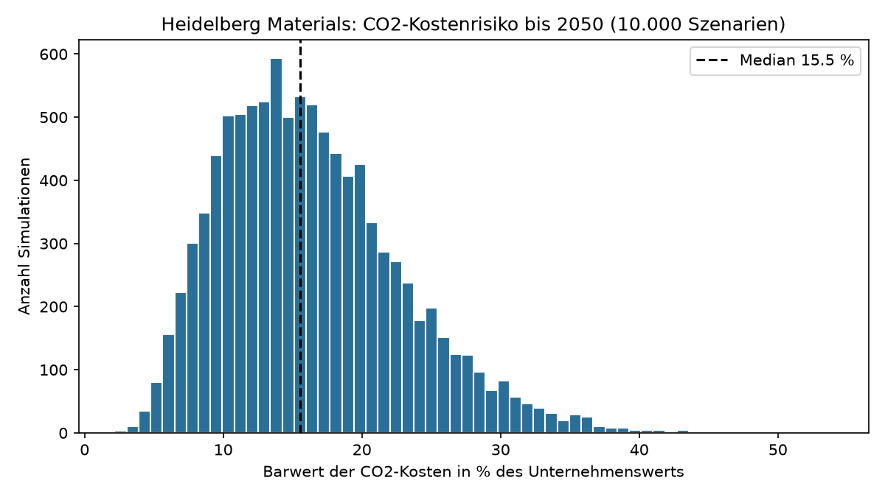
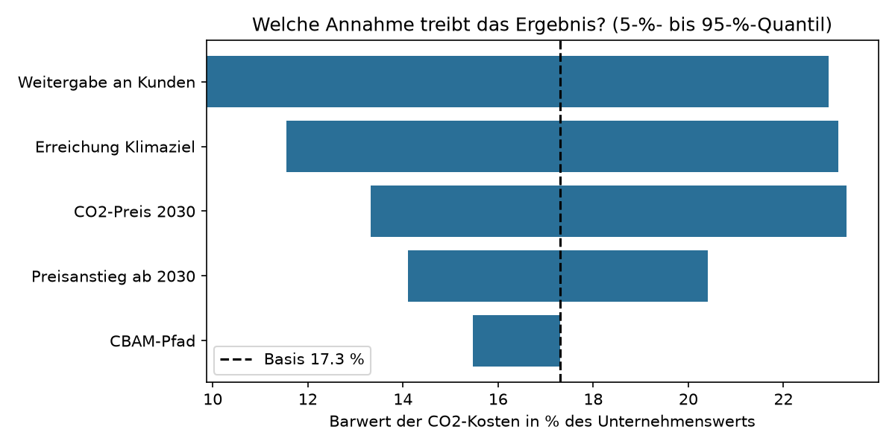

# CO₂-Stresstest für europäische Industriekonzerne

**Wie stark belasten steigende CO₂-Preise und das Auslaufen der kostenlosen Zertifikate den Unternehmenswert?**

👉 **Live-App:** https://carbon-cost-stresstest-vmyx7wluub57ehjqgr7lgi.streamlit.app

## Ergebnis (Pilot: Heidelberg Materials)

- Im mittleren Szenario entsprechen die künftigen CO₂-Kosten **rund 15 % des Unternehmenswerts** (Median aus 10.000 Szenarien).
- Mit 90 % Wahrscheinlichkeit liegt der Wert **zwischen 7 % und 28 %**, in etwa jedem vierten Szenario über 20 %.
- Die stärksten Treiber sind **Preissetzungsmacht** (Weitergabe an Kunden) und **Dekarbonisierungstempo**, beide vom Unternehmen selbst beeinflussbar. Der politische CBAM-Pfad macht nur rund 2 Prozentpunkte aus.
- Heute deckt die Gratiszuteilung die Emissionen fast vollständig. **Das Risiko liegt fast ausschließlich in der Zukunft** (ab 2029).

## Methode

1. **Daten:** Anlagen-Emissionen und Gratiszuteilung aus dem EU-Emissionshandelsregister (Union Registry), Finanzkennzahlen aus dem Geschäftsbericht 2025.
2. **Modell:** Jahresrechnung 2026–2050 mit schrumpfender Gratiszuteilung (CBAM: geltendes Recht vs. Kommissionsvorschlag 2026), Steuern, Diskontierung mit dem WACC des Konzerns und Restwert.
3. **Monte-Carlo-Simulation** über CO₂-Preis, Preisanstieg, Weitergabe an Kunden, Zielerreichung und CBAM-Pfad, dazu eine **Tornado-Sensitivitätsanalyse**.
4. **KI-Extraktion:** Gemini liest Kennzahlen aus Geschäftsberichten, jeweils mit **Seitenzahl und wörtlichem Zitat als Prüfspur**. Jede Antwort wird automatisch gegen eine manuell geprüfte Referenz abgeglichen und das Zitat auf der genannten Seite gesucht (Halluzinations-Check).

Alle Annahmen mit Quelle: [`annahmen.md`](annahmen.md)

## Projektstruktur

| Datei | Inhalt |
|---|---|
| `app.py` | Web-App (Streamlit) |
| `src/modell.py` | Kernmodell: Jahresrechnung, Barwert, Monte Carlo |
| `src/ets_heidelberg.py` | Auswertung des EU-ETS-Registers |
| `src/ki_extraktion.py` | KI-Extraktion mit automatischer Prüfung |
| `src/monte_carlo.py` | Simulation und Grafiken |
| `annahmen.md` | Alle Annahmen, Quellen und Datenentscheidungen |

## Selbst ausführen
pip install -r requirements.txt
streamlit run app.py

## Grenzen

- Nur direkte Emissionen (Scope 1) in Ländern mit CO₂-Preis
- Weitergabe an Kunden als Annahme, ohne Mengeneffekt
- Investitionskosten der Dekarbonisierung (z. B. CO₂-Abscheidung) nicht enthalten
- Das Modell misst das Risiko, es ist keine Kursprognose und keine Anlageberatung

---
*Privates Studienprojekt von Hugo Röske (HSBA Hamburg School of Business Administration). Ausschließlich öffentliche Daten.*