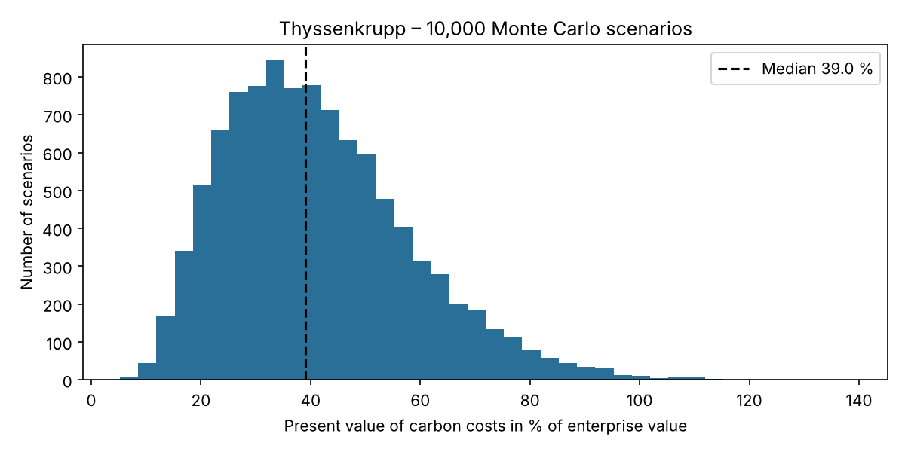
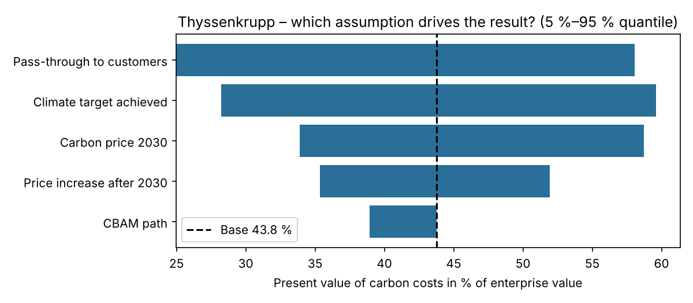

# CarbonCliff – a carbon cost stress test for European heavy industry

**How much enterprise value is at risk when free EU carbon allowances are phased out?**

👉 **Live app:** https://carbon-cost-stresstest-mkabmepkuodutcbnnm2x2l.streamlit.app

## Why this matters

Steel, cement and fertiliser producers still receive most of their EU emission allowances for free. Under the Carbon Border Adjustment Mechanism (CBAM), this free allocation is phased out between 2026 and 2034. Today's financial statements barely show the resulting cost: in 2025, Thyssenkrupp received more allowances than it emitted. CarbonCliff turns this future cost into one number per company – its present value as a share of enterprise value – and shows how uncertain that number is.

## Results (pilot: Thyssenkrupp)

Default assumptions: carbon price €100/t in 2030, 40 % pass-through to customers, current law.

- Future carbon costs are worth **€4.3bn today, or 48 % of enterprise value**.
- Across 10,000 Monte Carlo scenarios the **median is 39 %**; the 90 % range is **18 % to 73 %**.
- Free allocation covers **105 %** of 2025 emissions, so the model expects **no purchases until 2029** – the cost appears from 2030.
- If emission reductions are delayed by **5 years** (e.g. the planned DR plant), the share rises to **66 %**.
- The strongest drivers are **pass-through to customers** and **decarbonisation progress**, both partly under the company's control. The choice of CBAM path matters least.




These are model results under stated assumptions, not a forecast of share prices and not investment advice.

## Ranking: who is hit hardest?

Seven EU steel, cement and aluminium companies, all calculated with the same assumptions (8 % discount rate, emissions held at the 2025 level, 40 % pass-through):

| Rank | Company | Sector | Free allocation coverage 2025 | PV of carbon costs | % of enterprise value |
|---|---|---|---|---|---|
| 1 | Thyssenkrupp | Steel | 105 % | €6.4bn | 71 % |
| 2 | Salzgitter | Steel | 93 % | €3.3bn | 67 % |
| 3 | voestalpine | Steel | 77 % | €4.9bn | 50 % |
| 4 | SSAB | Steel | 91 % | €3.3bn | 40 % |
| 5 | ArcelorMittal | Steel | 133 % | €9.7bn | 19 % |
| 6 | Holcim | Cement | 109 % | €4.3bn | 10 % |
| 7 | Norsk Hydro | Aluminium | 89 % | €0.7bn | 5 % |

Thyssenkrupp shows 71 % here but 48 % in the detailed model above, because the ranking uses common assumptions (8 % discount rate instead of 7.6 %, 25 % tax, no emission reductions until 2030).

The order is the same under all tested variants (pass-through 20–60 %, Commission proposal, 10 % WACC, €150/t). The key driver is how large EU emissions are relative to enterprise value: integrated steelmakers with a small market value carry the largest exposure, while diversified groups dilute it. Details and limitations in the app (page "Ranking") and in [`annahmen.md`](annahmen.md).

## Method

1. **Data:** installation-level verified emissions and free allocation from the EU Union Registry; financial figures from annual reports.
2. **ETS matching with reconciliation:** installations are assigned to the company (joint ventures pro rata) and summed per site, then reconciled with the reported Scope 1 emissions (Thyssenkrupp: 19.48 vs. 19.8 Mt, −1.6 %).
3. **Model:** annual cost path 2026–2050 with declining free allocation (CBAM: current law vs. Commission proposal 2026), taxes, discounting at the company's after-tax WACC, and a terminal value.
4. **Uncertainty:** Monte Carlo simulation over carbon price, price growth, pass-through, target achievement and CBAM path, plus a tornado sensitivity analysis.
5. **Company scenarios:** delayed decarbonisation, share of emissions outside the EU ETS, spin-off of a segment.
6. **AI extraction with an audit trail:** Gemini reads key figures from annual reports and must return the **page number and a verbatim quote**. The code checks automatically that the quote appears on that page; a human then verifies every value before it enters the model (four-eyes principle).

All assumptions with sources: [`annahmen.md`](annahmen.md)

## Project structure

| File | Content |
|---|---|
| `app.py` | Web app (Streamlit) |
| `pages/1_Bericht_auswerten.py` | Upload page: analyse a new annual report (runs locally only) |
| `pages/2_Ranking.py` | Ranking of companies with common assumptions |
| `src/ranking_daten.json` | Ranking input data with sources |
| `src/modell.py` | Core model: annual cost path, present value, Monte Carlo, tornado, scenarios |
| `src/ets_thyssenkrupp.py` | EU ETS matching and reconciliation for Thyssenkrupp |
| `src/ets_suche.py` | Search the EU ETS registry for a new company |
| `src/ki_extraktion.py` | AI extraction with automatic quote check |
| `src/bericht_auswertung.py` | AI extraction for uploaded reports |
| `annahmen.md` | All assumptions, sources and data decisions |

Code comments and variable names are in German.

## Run it yourself

```
pip install -r requirements.txt
streamlit run app.py
```

## Limitations

- Only direct emissions (Scope 1) under the EU ETS; carbon prices outside the EU are not modelled.
- ETS matching is plausibility-checked by reconciliation, not proven.
- Pass-through to customers is an assumption, without volume effects.
- Decarbonisation capex (e.g. new plants) is not included.
- The Commission proposal COM(2026) 616 has not been adopted.

---
*Private student project by Hugo Röske. Public data only. Not investment advice.*
